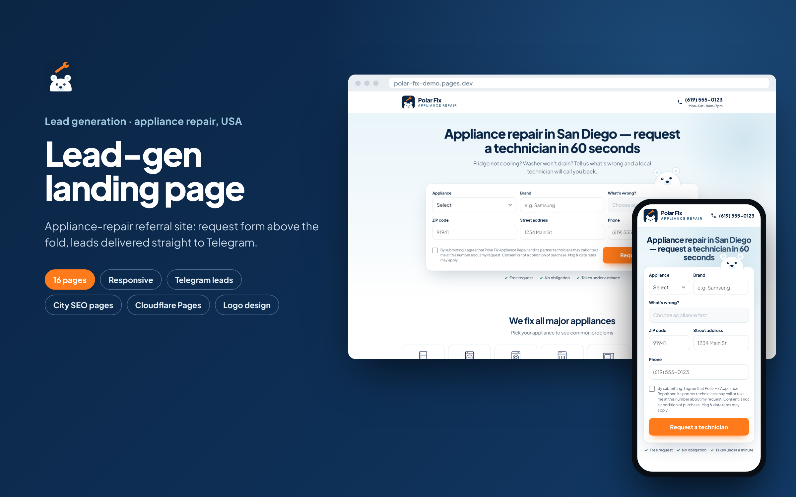
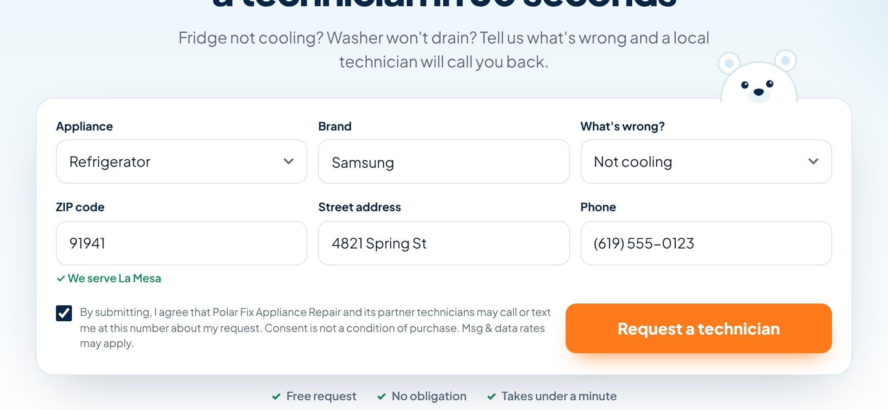
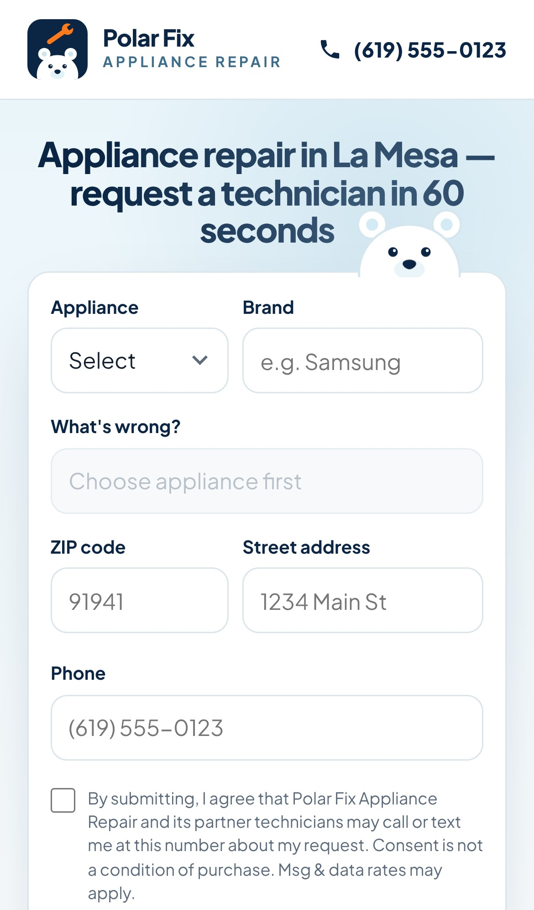
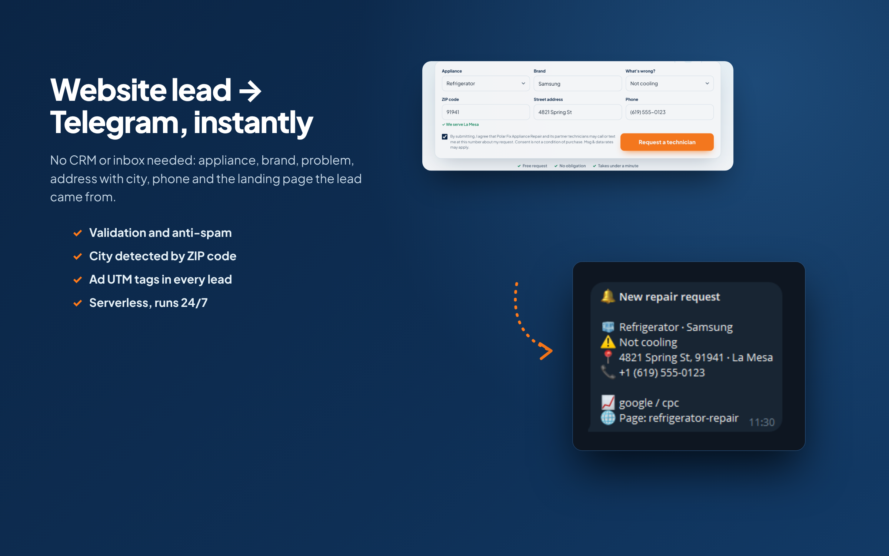

# Lead-Gen Landing for an Appliance Repair Service

A fast, serverless lead-generation website for a home appliance repair referral service in San Diego, CA.
Visitors fill in a short form on the first screen and the request lands in Telegram within seconds.

**Live demo:** https://polar-fix-demo.pages.dev

> "Polar Fix Appliance Repair" is a fictional demo brand. The phone number is a placeholder (555).



## Features

- **16 static pages:** home, 7 appliance pages (`/refrigerator-repair`, `/washer-repair`, …), 4 city pages, thank-you, privacy, terms, 404
- **Request form above the fold:** appliance → brand → problem (options depend on the appliance) → ZIP + address → phone. Fits on one phone screen
- **Instant service-area check** by ZIP code ("✓ We serve La Mesa")
- **Telegram delivery** through a Cloudflare Pages Function: appliance, problem, address with detected city, phone, landing page and UTM / gclid source
- **Spam protection:** honeypot field + minimum fill time; server-side validation of every field
- **TCPA consent** checkbox for US call/SMS leads
- **SEO:** a page per appliance and per city, FAQ, footer links, canonical-ready
- **Ad-ready:** separate `/thank-you` page for conversion tracking, UTM tags passed into each lead
- **Animated mascot** that follows the cursor (and the active field on mobile), hover and scroll animations with `prefers-reduced-motion` support
- **No server, no monthly cost:** static hosting + one serverless function on Cloudflare Pages

| Form in action | Mobile city page |
|---|---|
|  |  |



## Stack

HTML, CSS, vanilla JavaScript · Python static page generator · Cloudflare Pages Functions · Telegram Bot API

## Project structure

```
src/content.py           all texts: brand, phone, appliances, problems, cities + ZIP codes, FAQ
src/build.py             static generator → dist/
src/style.css, app.js    design, form logic, animations
functions/api/lead.js    POST /api/lead → validation, anti-spam, Telegram message
tests/lead.test.mjs      tests for validation and message formatting
logo/                    logo (SVG)
```

## Run and deploy

```bash
python src/build.py                    # build 16 pages into dist/
node tests/lead.test.mjs               # run tests
npx wrangler pages deploy dist --project-name <name>
npx wrangler pages secret put TELEGRAM_BOT_TOKEN --project-name <name>
npx wrangler pages secret put TELEGRAM_CHAT_ID --project-name <name>   # comma-separated for several chats
```

To add a city or change the phone number, edit `src/content.py` and rebuild.
